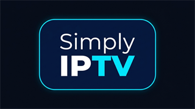

  

<h1 align="center">Simply IPTV</h1>

  <strong>A modern, fast, and lightweight IPTV player crafted natively for Android TV and Google TV.</strong>

  <a href="PRIVACY_POLICY.md">Privacy Policy</a> •
  <a href="TERMS_AND_CONDITION.md">Terms & Conditions</a> •
  <a href="RELEASES.md">Releases & Changelog</a> •
  <a href="https://github.com/pradumnk-mahanta/simply-iptv-docs/issues">Issue Tracker</a>

---

## About Simply IPTV

**Simply IPTV** is a high-performance IPTV player built from the ground up specifically for large screens, remotes, and Android TV / Google TV devices. Engineered with Google's modern Android development stack—including **Jetpack Compose for TV (Material 3)**, **AndroidX Media3 (ExoPlayer)**, and **Kotlin Coroutines**—it delivers an intuitive, broadcast-grade television experience.

---

## Key Features

*   **Native Android TV Interface**: Clean, fluid 10-foot UI designed specifically for D-Pad remote control navigation with focused contrast highlights and snappy navigation.
*   **Multi-Playlist Management**: Support for M3U and M3U8 playlists with automatic category grouping, channel logo resolution, and stream quality extraction (1080p, 4K, 720p, etc.).
*   **Electronic Program Guide (EPG)**: Full XMLTV guide support (`.xml` and `.xml.gz`) with timeline program progress, upcoming schedules, and custom playlist mappings.
*   **Instant Source Switching**: Seamlessly switch between multiple broadcast feeds and resolution tiers for the same channel on the fly via the Bottom Info Bar.
*   **Favourites Management**: Pin and organize your most-watched channels with a single click from the player or channel menu.
*   **Android TV "Continue Watching" Integration**: Directly publishes your recently played channels to the Android TV system home launcher row ("Watch Next") with dynamic 16:9 anti-crop channel cards.
*   **Automated Background Sync**: Scheduled background playlist and guide updates via Android WorkManager.
*   **Multi-Language Localization**: Fully localized in 10 global languages: English, German, Spanish, French, Italian, Portuguese, Russian, Turkish, Arabic, and Hindi.
*   **Privacy-First & Zero Bloat**: No advertising, no user telemetry, no tracking SDKs, and no external developer servers. All playlist URLs and user data remain strictly on your local device.

---

## Important Content Disclaimer

> **Simply IPTV does not provide, host, bundle, or distribute any media content, streams, TV channels, or playlists.**
> 
> Simply IPTV is strictly an application software utility for playing user-supplied media streams. Users must provide their own valid M3U / M3U8 playlist URLs and XMLTV EPG sources. Simply IPTV has no affiliation with any third-party IPTV providers or content broadcasters. We do not endorse or support unauthorized streaming of copyright-protected material.

---

## Legal & Policies

*   **[Privacy Policy](PRIVACY_POLICY.md)**: Details our zero-data-collection architecture, local storage mechanics, and Google Play Billing integration.
*   **[Terms and Conditions](TERMS_AND_CONDITION.md)**: Outlines acceptable use, content ownership responsibilities, subscription terms, and disclaimers.

---

## Tech Stack & Architecture

*   **UI Toolkit**: Jetpack Compose for TV (Material 3 Leanback)
*   **Media Engine**: AndroidX Media3 (ExoPlayer) with HLS, DASH, OkHttp, and Leanback Session integration
*   **Local Storage**: Android Room (SQLite) with multi-threaded DAO queries and DataStore Preferences
*   **Background Tasks**: Android Jetpack WorkManager
*   **Networking**: Square OkHttp 4
*   **Target SDK**: Android 16 (API 37) | **Minimum SDK**: Android 9.0 (API 28)

---

## Support & Feedback

Encountered an issue or have a feature request?
*   Open a ticket on our [GitHub Issue Tracker](https://github.com/pradumnk-mahanta/simply-iptv-docs/issues).
*   Contact developer: [support@itryto.win](mailto:support@itryto.win).

---

## License

This project is licensed under the [GNU General Public License](LICENSE).
